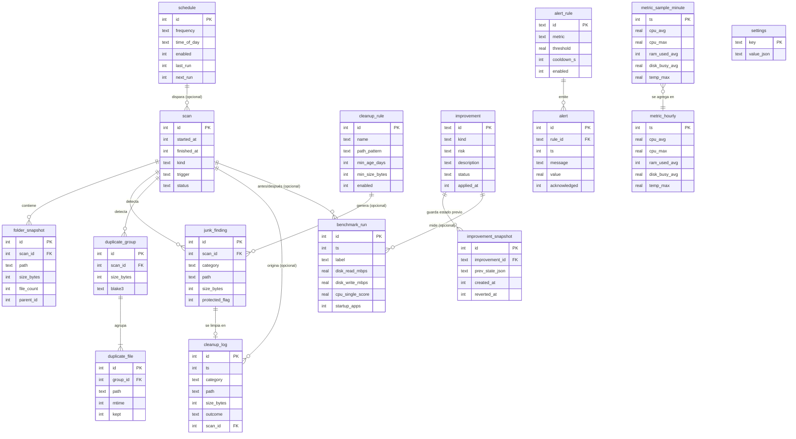

# Modelo de Datos

Persistencia: **SQLite local** (`rusqlite`), un único archivo en el directorio de datos de la app (**Decisión DD-15:** `%LOCALAPPDATA%\pc-optimizer\data.db` del perfil real del usuario interactivo; no itinerante). Migraciones versionadas (`PRAGMA user_version`). Timestamps en UTC, epoch milisegundos (INTEGER). Tamaños en bytes (INTEGER).

## Dominios

| Dominio | Entidades |
|---------|-----------|
| Escaneo y almacenamiento | `scan`, `folder_snapshot`, `junk_finding`, `duplicate_group`, `duplicate_file` |
| Limpieza | `cleanup_log`, `cleanup_rule` |
| Mejoras | `improvement`, `improvement_snapshot` |
| Monitoreo | `metric_sample_minute`, `metric_hourly` |
| Asistente | `alert`, `alert_rule`, `schedule` |
| Rendimiento | `benchmark_run` |
| Configuración | `settings` |

## ERD

## Entidades

### scan
- `id` INTEGER PK; `started_at`, `finished_at` INTEGER; `kind` TEXT (`full`, `junk`, `duplicates`, `folders`); `trigger` TEXT (`manual`, `scheduled`); `status` TEXT (`running`, `done`, `cancelled`, `error`); `schedule_id` FK nullable.
- Relaciones: 1:N con `folder_snapshot`, `junk_finding`, `duplicate_group`.
- Índice: `(started_at)`.
- Retención: **Suposición:** últimos 50 scans con sus hijos; los `folder_snapshot` periódicos usados para tendencias se conservan ~90 días.

### folder_snapshot
- `id`, `scan_id` FK, `path` TEXT, `size_bytes`, `file_count`, `parent_id` (autorreferencia, para treemap).
- Constraint: `UNIQUE(scan_id, path)`. Índice: `(path, scan_id)` para tendencias "qué carpeta crece más".
- Retención: snapshots periódicos ~90 días (**Suposición:** solo top-N carpetas por nivel para acotar tamaño).

### junk_finding
- `id`, `scan_id` FK, `category` TEXT (enum: `temp_user`, `temp_windows`, `browser_cache_chrome|edge|firefox|brave`, `old_logs`, `wu_cache`, `thumbnail_cache`, `crash_dumps`, `recycle_bin`, `custom_rule`), `path`, `size_bytes`, `protected_flag` (si cayó en ruta protegida, se persiste como omitido), `cleanup_rule_id` FK nullable.
- Constraint: `category` en el enum de la whitelist (CHECK).

### duplicate_group / duplicate_file
- `duplicate_group`: `id`, `scan_id`, `size_bytes`, `blake3` (hash completo, hex).
- `duplicate_file`: `id`, `group_id` FK, `path`, `mtime`, `kept` (decisión del usuario; nunca auto-asignada).
- Índices: `(scan_id, size_bytes)`, `(blake3)`.
- Retención: junto con su `scan`.

### cleanup_log
- `id`, `ts`, `category`, `path`, `size_bytes`, `outcome` (`moved_to_trash`, `skipped_locked`, `skipped_protected`, `skipped_cloud`, `error`, `recycle_bin_emptied`), `scan_id` FK nullable, `error_detail` nullable.
- Append-only (sin UPDATE/DELETE desde la app). Índice `(ts)`.
- Retención: **Suposición:** indefinida (es auditoría; volumen bajo). Purga manual en Configuración.

### cleanup_rule
- `id`, `name`, `path_pattern` (glob), `min_age_days`, `min_size_bytes`, `enabled`.
- Constraint: validación en dominio; la regla **nunca** puede incluir rutas protegidas (RN-PROT).

### improvement
- `id` TEXT (identificador de catálogo cerrado, ej. `startup.disable:<entry>`, `power.plan:<guid>`, `visual.preset:<name>`, `cleanup.whitelist:<category>`), `kind` (`startup`, `power_plan`, `visual_effects`, `cleanup`), `risk` (`bajo|medio|alto`), `estimated_impact` TEXT, `status` (`available`, `applied`, `reverted`), `applied_at`.
- El catálogo vive en código (lista cerrada); la tabla registra estado.

### improvement_snapshot
- `id`, `improvement_id` FK, `prev_state_json` (estado exacto previo: valor de registro/entrada de inicio/plan activo/preset), `created_at`, `reverted_at` nullable.
- Se crea **antes** de aplicar; sin snapshot no se aplica (RN-MEJ-02). Retención: mientras la mejora esté `applied`; tras revertir, ~90 días.

### metric_sample_minute
- `ts` PK (minuto), `cpu_avg`, `cpu_max`, `ram_used_avg`, `disk_busy_avg`, `temp_max` (nullable: puede no estar disponible).
- Retención: **24 h** (purga rolling). El muestreo de 1-2 s vive solo en memoria.

### metric_hourly
- Mismos campos agregados por hora. Retención: **~90 días**. Alimenta tendencias semanales.

### alert_rule
- `id`, `metric` (`disk_used_pct`, `temp`, `ram_pressure`), `threshold` REAL, `cooldown_s`, `enabled`. Defaults (**Suposición**): disco > 90 %, temperatura CPU/GPU > 85 °C, RAM > 90 % por >= 60 s; cooldown 6 h.

### alert
- `id`, `rule_id` FK, `ts`, `message`, `value`, `acknowledged`. Retención: **Suposición:** 90 días.

### schedule
- `id`, `frequency` (`daily|weekly`), `time_of_day`, `day_of_week` nullable, `enabled`, `last_run`, `next_run`.

### benchmark_run
- `id`, `ts`, `label` (`before|after|manual`), `disk_read_mbps`, `disk_write_mbps`, `cpu_single_score`, `startup_apps`, `related_improvement_id` / `related_scan_id` nullables. Retención: **Suposición:** 90 días.

### settings
- Clave/valor JSON: `ui_mode` (`simple|advanced`), `autostart_tray`, umbrales, `scan_roots`, `language`, `report_prefs`. Ver 12 y 13.

## Seed data inicial

- `settings`: `ui_mode=simple`, `autostart_tray=false`, idioma `es`.
- `alert_rule`: tres reglas default (disco, temperatura, RAM) con valores **Suposición** de arriba.
- `schedule`: ninguno habilitado hasta que el usuario active el asistente (v0.3).
- Catálogo de `improvement` y categorías de basura: definidos en código, no en seed SQL.
