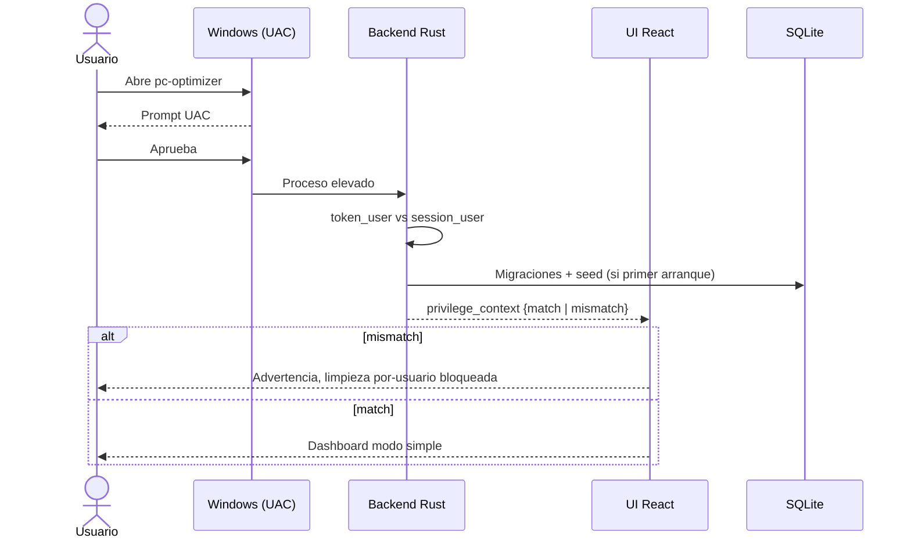
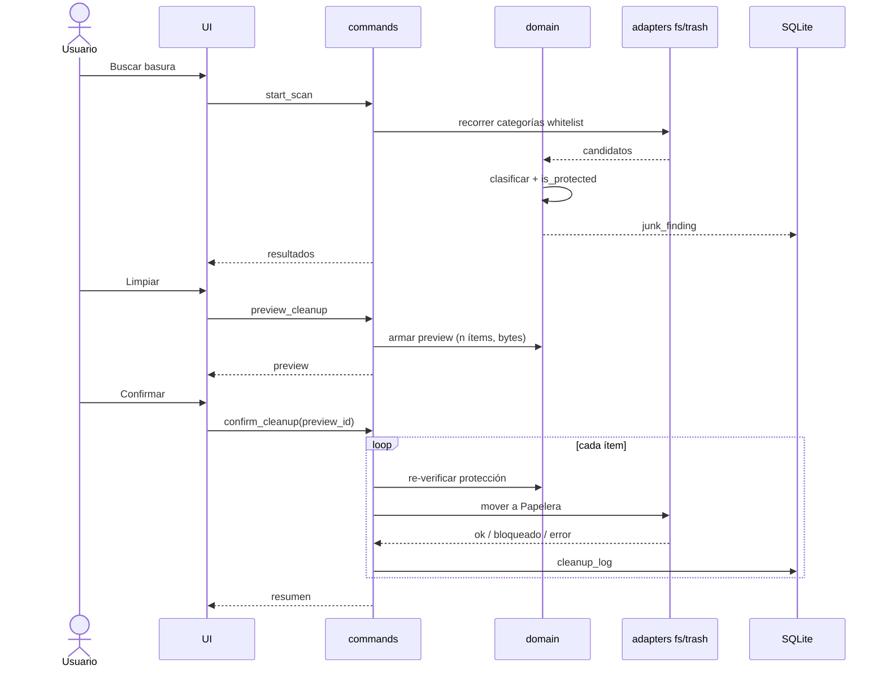
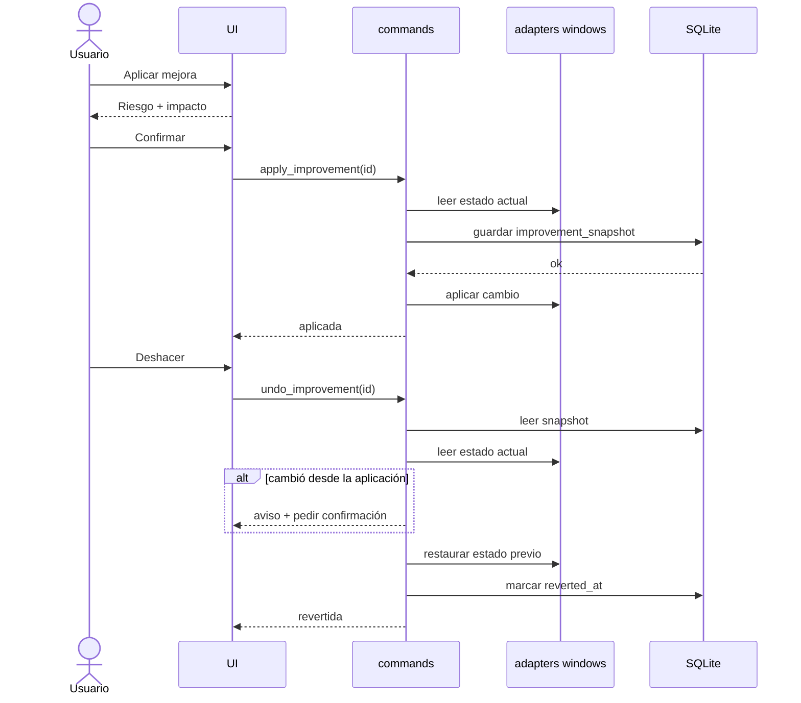
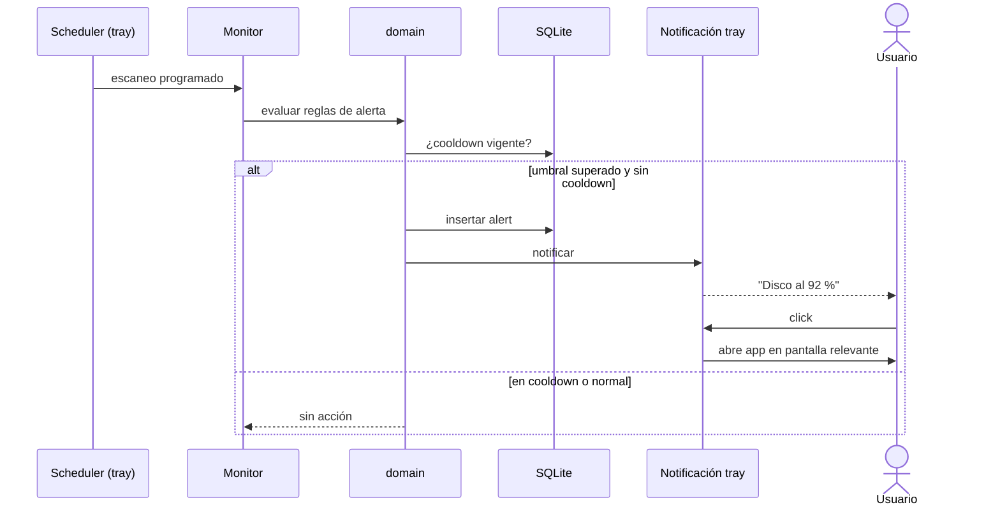
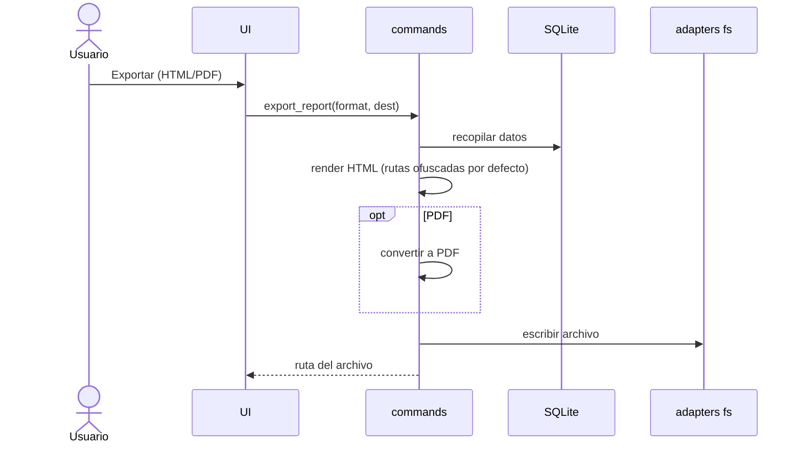

# Flujos Principales

Cada flujo está documentado extremo a extremo. Actores técnicos: UI (React), IPC (comandos Tauri), Dominio (Rust puro), Adaptadores (FS/Trash/SQLite/Win32).

## Flujo 1: Primer arranque, UAC y verificación de perfil

**Disparador**: el usuario abre la app.
**Actor**: Usuario / Windows.

**Pasos**:
1. Windows muestra UAC (manifest `requireAdministrator`).
2. Si el usuario cancela, la app no inicia.
3. Backend consulta el contexto de privilegios: usuario del token elevado vs usuario de la sesión interactiva.
4. Si coinciden, se continúa; si difieren (over-the-shoulder), se muestra advertencia y se bloquea la limpieza por-usuario.
5. Primer arranque: se crean DB y settings seed, UI en modo simple.

**Casos de error**:
- UAC cancelado → la app no arranca (sin degradación a modo no elevado).
- No se puede determinar el usuario de sesión → **Suposición:** se trata como mismatch (política de no tocar).
- DB corrupta o migración fallida → mensaje claro, se ofrece respaldo y recreación.

## Flujo 2: Escaneo → revisión → preview → confirmación → Papelera → log

**Disparador**: el usuario pulsa "Buscar basura" (o "Analizar").
**Actor**: Usuario.

**Pasos**:
1. UI invoca `start_scan`; backend recorre solo categorías whitelisted (sin seguir junctions).
2. Cada candidato pasa por `is_protected(path)` sobre ruta canónica.
3. Se emiten eventos de progreso; resultados en `junk_finding`.
4. Usuario revisa hallazgos (modo simple: tarjetas por categoría; avanzado: rutas).
5. UI pide `preview_cleanup`: dominio devuelve ítems, cantidad y tamaño totales.
6. Usuario confirma explícitamente.
7. `confirm_cleanup` re-verifica protección (anti-TOCTOU) y mueve cada ítem a la Papelera; omite bloqueados/cloud-only.
8. Se escribe `cleanup_log` y se muestra resumen (liberado, omitidos).

**Casos de error**:
- Archivo en uso → `skipped_locked`, se reporta, no se fuerza.
- Ruta resultó protegida al re-verificar → `skipped_protected`.
- Placeholder OneDrive → `skipped_cloud`.
- Permiso denegado/IO error → `error` con detalle; el resto continúa.
- Usuario cierra el preview → no se ejecuta nada.

## Flujo 3: Aplicar mejora → snapshot → undo

**Disparador**: el usuario pulsa "Aplicar" en una mejora.
**Actor**: Usuario.

**Pasos**:
1. UI muestra riesgo (bajo/medio/alto) e impacto estimado.
2. Usuario confirma.
3. Backend lee el estado actual y lo guarda en `improvement_snapshot`.
4. Solo si el snapshot se persistió, aplica el cambio.
5. Para deshacer: lee el snapshot, compara con estado actual, restaura estado exacto y marca `reverted_at`.

**Casos de error**:
- Falla el guardado del snapshot → no se aplica.
- Falla la aplicación → se descarta/marca el snapshot, se informa.
- Estado externo cambió antes del undo → advertencia y confirmación (RN-MEJ-04).

## Flujo 4: Escaneo programado → alerta desde la bandeja

**Disparador**: llega la hora del `schedule` o una métrica supera un umbral.
**Actor**: Sistema/Scheduler.

**Pasos**:
1. El scheduler (dentro del proceso de bandeja) dispara un escaneo `trigger=scheduled`.
2. El monitor evalúa `alert_rule` contra las métricas agregadas.
3. Si se supera un umbral y no está en cooldown, se crea `alert` y se muestra notificación de bandeja.
4. Usuario hace click en la notificación; se abre la app (ya elevada) en la pantalla relevante.
5. Cualquier limpieza posterior sigue el Flujo 2.

**Casos de error**:
- App cerrada: según pregunta abierta, el escaneo no corre (o lo dispara Task Scheduler; ver 10).
- Sensor no disponible → la regla de temperatura no evalúa y no alerta.

## Flujo 5: Exportar reporte

**Disparador**: el usuario pulsa "Exportar reporte".
**Actor**: Usuario.

**Pasos**:
1. UI elige formato (HTML/PDF) y destino.
2. Backend recopila score, hallazgos, `cleanup_log`, mejoras, tendencias y benchmark.
3. Dominio genera el HTML (plantilla local).
4. PDF: según decisión abierta (impresión del webview vs crate Rust).
5. Se guarda el archivo local y se ofrece abrir la carpeta.

**Casos de error**:
- Destino sin permisos / disco lleno → mensaje y reintento con otro destino.
- Sin datos suficientes (ej. sin benchmark) → la sección se omite, indicándolo.
